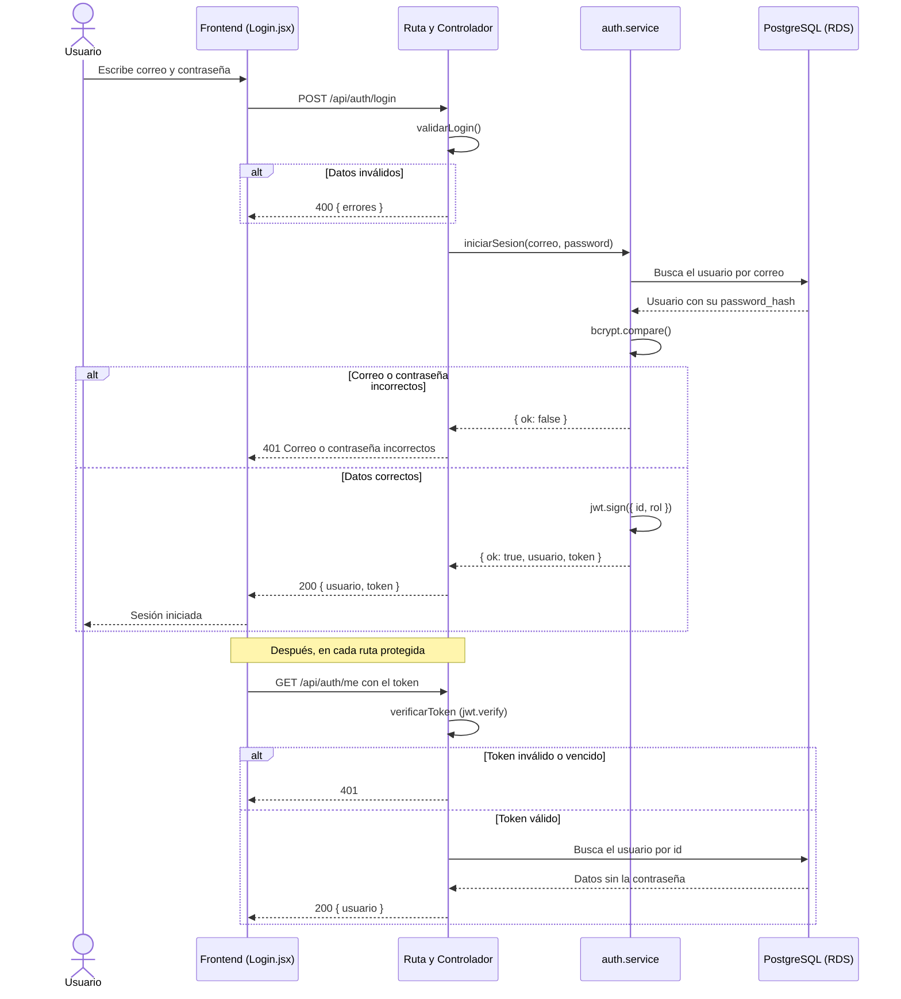

# BackendClinica

Backend del proyecto Clínica NutriVida (DSY1104 - Full Stack II).
Está hecho con Node.js y Express, usa PostgreSQL en Amazon RDS y corre en una instancia EC2.

Repositorio del frontend: https://github.com/JordanaCharlotte/Clinica.git

## Cómo ejecutarlo

1. Instalar las dependencias con `npm install`
2. Crear el archivo `.env` con los datos de la base de datos y la clave `JWT_SECRET`
3. Cargar los datos de prueba con `npm run seed`
4. Iniciar el servidor con `npm start`

## Autenticación

Esta parte la hice yo (Jordana). Incluye el registro, el login y la ruta para saber quién inició sesión.

| Método | Ruta | ¿Pide token? | Para qué sirve |
|---|---|---|---|
| POST | `/api/auth/register` | No | Crear una cuenta nueva |
| POST | `/api/auth/login` | No | Iniciar sesión y recibir el token |
| GET | `/api/auth/me` | Sí | Ver los datos del usuario que inició sesión |

Cuando una ruta pide token, hay que mandarlo así en los headers:
`Authorization: Bearer <token>`

### Decisiones que tomamos

- **Las contraseñas se guardan con bcrypt.** Así en la base de datos nunca queda la contraseña real, solo un hash.
- **El registro siempre crea usuarios con rol cliente.** Aunque alguien mande `"rol": "admin"`, se ignora. Los administradores no se pueden registrar solos.
- **El token dura 15 minutos** y solo guarda el id y el rol, nada de datos personales.
- **El login responde el mismo mensaje** si el correo no existe o si la contraseña está mala. Así nadie puede averiguar qué correos están registrados.
- **Usamos las mismas validaciones del frontend** (RUN, correo y contraseña), para que los mensajes de error sean iguales en los dos lados.

### Errores 401 y 403

| Código | Qué significa | Cuándo pasa | Mensaje |
|---|---|---|---|
| 401 | No hay sesión | No se mandó el token, venció o lo modificaron | `Debes iniciar sesión.` / `Tu sesión expiró. Vuelve a iniciar sesión.` |
| 401 | Login fallido | El correo o la contraseña están malos | `Correo o contraseña incorrectos.` |
| 403 | No tiene permiso | Hay sesión, pero el usuario no tiene el rol que pide la ruta (por ejemplo, un cliente en una ruta de admin) | `No tienes permiso para esta acción.` |

La diferencia: con **401** el backend no sabe quién eres, y con **403** sabe quién eres, pero no te deja hacer esa acción.

Para que una ruta sea solo para administradores, se agregan los dos middleware antes del controlador:

```js
router.delete('/:id', verificarToken, permitirRoles('admin'), cancelar);
```

También pueden aparecer el **400** (datos inválidos) y el **409** (el correo o el RUN ya están registrados).

### Diagrama de secuencia del login


