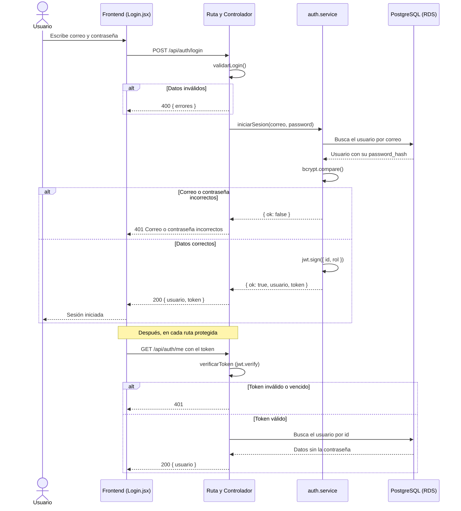

# BackendClinica

Backend del proyecto Clínica NutriVida (DSY1104 - Full Stack II).
Está hecho con Node.js y Express, usa PostgreSQL en Amazon RDS y corre en una instancia EC2.

Repositorio del frontend: https://github.com/JordanaCharlotte/Clinica.git

## Cómo ejecutarlo

1. Instalar las dependencias con `npm install`
2. Crear el archivo `.env` con los datos de la base de datos y la clave `JWT_SECRET`
3. Cargar los datos de prueba con `npm run seed`
4. Iniciar el servidor con `npm start`

## Integrantes

- Jordana Vasquez
- Davis Monsalvez
- Vicente Jaramillo

## Nombre del proyecto

Clínica NutriVida

## Descripción

La clínica permite consultar servicios nutricionales y agendar citas con profesionales. El frontend está desarrollado con React y Vite. En la versión anterior, los datos se manejaban principalmente mediante datos simulados y `localStorage`. En esta etapa se implementa un backend para centralizar la información, autenticar usuarios y conectarse con PostgreSQL.

## Tecnología elegida

Elegimos Node.js y Express porque el frontend de Clínica NutriVida ya está desarrollado en JavaScript. Esto permite mantener el mismo lenguaje en frontend y backend y facilita la migración de los servicios actuales hacia una API.

## Arquitectura

La arquitectura utiliza un backend desarrollado con Node.js y Express, conectado a una base de datos PostgreSQL en Amazon RDS. La estructura planificada es:

`Backend Node.js/Express → Amazon RDS PostgreSQL`

## Entidades

Las entidades principales son:

- `usuarios`: personas que utilizan el sistema, incluyendo clientes y administradores.
- `servicios`: consultas, planes, evaluaciones y talleres disponibles.
- `nutricionistas`: profesionales que atienden las citas.
- `citas`: reservas realizadas por usuarios para un servicio y un nutricionista.


## Autenticación

Esta parte la hice yo (Jordana). Incluye el registro, el login y la ruta para saber quién inició sesión.

| Método | Ruta | ¿Pide token? | Para qué sirve |
|---|---|---|---|
| POST | `/api/auth/register` | No | Crear una cuenta nueva |
| POST | `/api/auth/login` | No | Iniciar sesión y recibir el token |
| GET | `/api/auth/me` | Sí | Ver los datos del usuario que inició sesión |

Cuando una ruta pide token, hay que mandarlo así en los headers:
`Authorization: Bearer <token>`

### Decisiones que tomamos

- **Las contraseñas se guardan con bcrypt.** Así en la base de datos nunca queda la contraseña real, solo un hash.
- **El registro siempre crea usuarios con rol cliente.** Aunque alguien mande `"rol": "admin"`, se ignora. Los administradores no se pueden registrar solos.
- **El token dura 15 minutos** y solo guarda el id y el rol, nada de datos personales.
- **El login responde el mismo mensaje** si el correo no existe o si la contraseña está mala. Así nadie puede averiguar qué correos están registrados.
- **Usamos las mismas validaciones del frontend** (RUN, correo y contraseña), para que los mensajes de error sean iguales en los dos lados.

### Errores 401 y 403

| Código | Qué significa | Cuándo pasa | Mensaje |
|---|---|---|---|
| 401 | No hay sesión | No se mandó el token, venció o lo modificaron | `Debes iniciar sesión.` / `Tu sesión expiró. Vuelve a iniciar sesión.` |
| 401 | Login fallido | El correo o la contraseña están malos | `Correo o contraseña incorrectos.` |
| 403 | No tiene permiso | Hay sesión, pero el usuario no tiene el rol que pide la ruta (por ejemplo, un cliente en una ruta de admin) | `No tienes permiso para esta acción.` |

La diferencia: con **401** el backend no sabe quién eres, y con **403** sabe quién eres, pero no te deja hacer esa acción.

Para que una ruta sea solo para administradores, se agregan los dos middleware antes del controlador:

```js
router.delete('/:id', verificarToken, permitirRoles('admin'), cancelar);
```

También pueden aparecer el **400** (datos inválidos) y el **409** (el correo o el RUN ya están registrados).

### Diagrama de secuencia del login




## Módulo de citas

| Método | Ruta | ¿Necesita token? | ¿Quién puede usarla? | Qué hace |
|---|---|---|---|---|
| POST | `/api/citas` | Sí | Usuario autenticado | Crea una nueva cita para el usuario que inició sesión |
| GET | `/api/citas` | Sí | Usuario autenticado | Lista las citas propias; el administrador puede ver todas |
| GET | `/api/citas/:id` | Sí | Usuario autenticado | Obtiene una cita específica |
| PATCH | `/api/citas/:id/reprogramar` | Sí | Solo administrador | Cambia la fecha u hora de una cita |
| DELETE | `/api/citas/:id` | Sí | Solo administrador | Cambia el estado de la cita a cancelada |

El token se envía en cada solicitud protegida mediante el encabezado `Authorization: Bearer <token>`. Para crear una cita se deben enviar el servicio, el nutricionista, la fecha, la hora, el nombre, el correo y el precio. El usuario asociado se obtiene desde el token JWT mediante `req.usuario.id`, por lo que no se recibe directamente desde el frontend. El módulo valida que los campos obligatorios estén completos y que la fecha no sea anterior al día actual.

Las citas se almacenan en la tabla `citas` de PostgreSQL. Al cancelar una cita no se elimina el registro de la base de datos, sino que su estado cambia a `cancelada`.

La funcionalidad se organiza en capas: `cita.route.js` define las rutas y aplica la autenticación y los permisos; `cita.controller.js` recibe las solicitudes y envía las respuestas; `cita.service.js` contiene las validaciones y reglas de negocio; y `cita.repository.js` ejecuta las consultas SQL sobre PostgreSQL.


## Módulo de Servicios y Nutricionistas

Se implementó el backend individual para el catálogo de servicios y nutricionistas de la clínica NutriVida. El módulo permite consultar información almacenada en PostgreSQL mediante una API REST desarrollada con Node.js y Express.

### Endpoints implementados

| Método | Endpoint | Descripción |
|---|---|---|
| GET | `/api/servicios` | Obtiene todos los servicios registrados |
| GET | `/api/servicios/:id` | Obtiene un servicio por su ID |
| GET | `/api/nutricionistas` | Obtiene todos los nutricionistas registrados |
| GET | `/api/nutricionistas/:id` | Obtiene un nutricionista por su ID |

### Validaciones realizadas

- Se valida que el ID de un servicio sea numérico y positivo.
- Se valida que el servicio exista.
- Se valida que el nutricionista exista.
- Se responde con estado `404 Not Found` cuando el registro no existe.
- Se responde con estado `400 Bad Request` cuando el ID del servicio no es válido.
- Se valida la disponibilidad de los servicios al consultar el detalle.
- Las rutas del catálogo son públicas y no requieren autenticación.

### Arquitectura utilizada

```text
Frontend React/Vite
        ↓
Node.js + Express en EC2
        ↓
PostgreSQL en Amazon RDS

El flujo del módulo es: `Ruta → Middleware de autenticación → Controlador → Servicio → Repositorio → PostgreSQL`.


