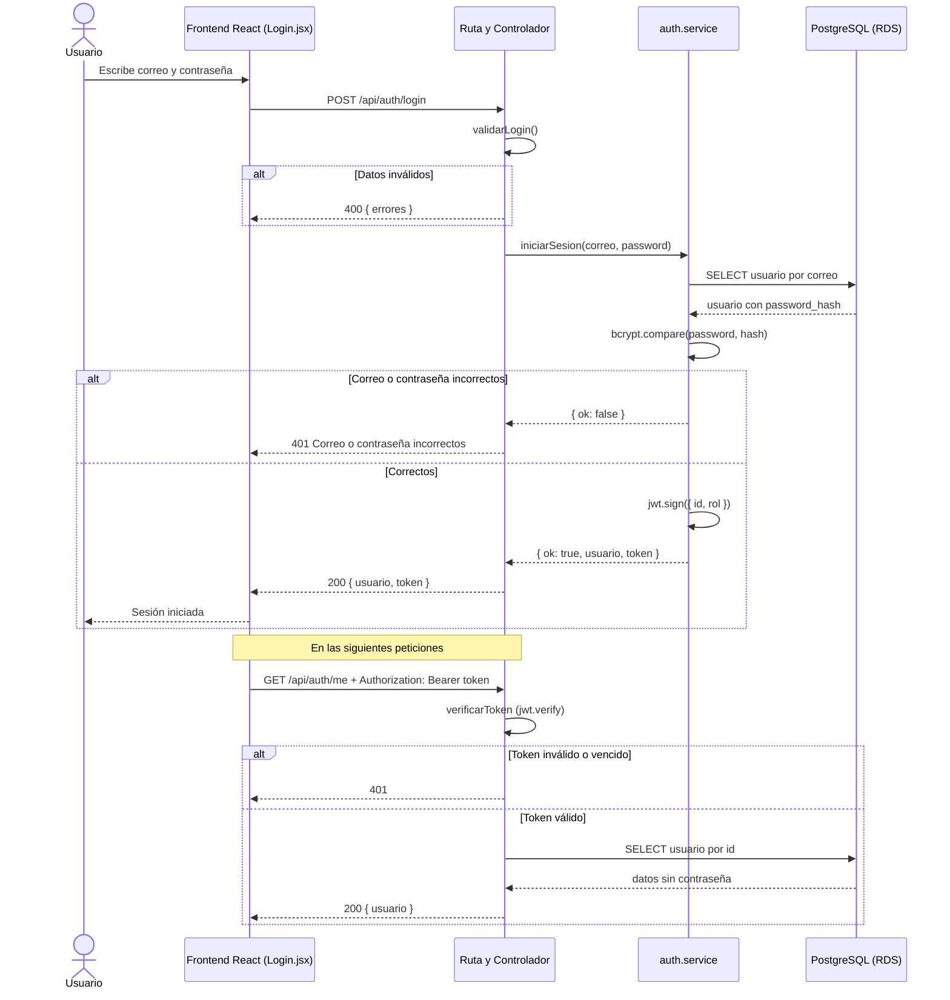

# BackendClinica

Enlace para Frontend del proyecto: https://github.com/JordanaCharlotte/Clinica.git

## Autenticación

| Método | Ruta | ¿Necesita token? | Qué hace |
|---|---|---|---|
| POST | `/api/auth/register` | No | Crea una cuenta. Siempre queda con rol `cliente` |
| POST | `/api/auth/login` | No | Revisa correo y contraseña y entrega un token |
| GET | `/api/auth/me` | Sí | Devuelve los datos de quien inició sesión |

El token se envía en cada ruta protegida con el encabezado:
`Authorization: Bearer <token>`

Las contraseñas se guardan cifradas con **bcrypt**. El token dura **15 minutos** y solo lleva el id y el rol del usuario.

### Errores 401 y 403

| Código | Significado | Cuándo aparece | Respuesta |
|---|---|---|---|
| **401** | No sé quién eres | No se envió token, el token venció o fue modificado | `{ "error": "Debes iniciar sesión." }` o `{ "error": "Tu sesión expiró. Vuelve a iniciar sesión." }` |
| **401** | Datos de acceso incorrectos | Login con correo o contraseña incorrectos | `{ "ok": false, "error": "Correo o contraseña incorrectos." }` |
| **403** | Sé quién eres, pero no tienes permiso | Un cliente intenta una acción de administrador | `{ "error": "No tienes permiso para esta acción." }` |

Para proteger una ruta solo para administradores:

```js
router.delete('/:id', verificarToken, permitirRoles('admin'), cancelar);
```

Otros errores: **400** datos inválidos · **409** el correo o el RUN ya existen.

### Diagrama de secuencia del login


